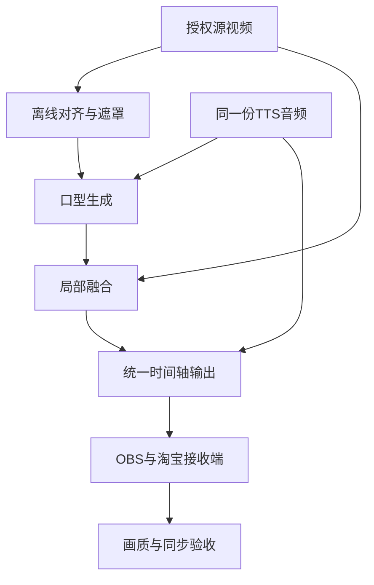

# 数字人画质、细节与口型控制方案

日期：2026-10-31。状态：开发与验收设计；v0.1已落实同源WAV适配、旧批次隔离和人工核验档案，尚未运行真实模型、制作客户样片或完成真实淘宝直播验证。逐项验证状态见[交付记录](IMPLEMENTATION_STATUS.md)。

本方案对应用户提出的失真、脸部细节和口型细节问题。首期目标是在约定人物、构图、语速、硬件与平台链路下达到可验收的实时直播效果；不承诺任意素材、任意角度或大脸特写都零失真。

## 1. 已核实的模型边界

MuseTalk 官方推荐 1.5，并公开了相应权重和实时推理方式；其生成人脸区域仍为256×256。官方同时列出胡须、唇形、唇色保留不足及逐帧生成抖动等限制。输出720p或1080p画布不能据此称为原生同分辨率的嘴部生成。[Q01]

作者论文讨论了牙齿清晰度与口型同步的训练权衡，并采用人脸分割与边缘融合减少回贴接缝。这些方法能够改善结果，不能保证人物真实牙齿、舌头等口腔结构精确复原。[Q02]

LiveTalking 的 MuseTalk 素材说明要求使用闭嘴、不说话的视频；上游 MuseTalk 推荐25fps输入。实施时必须核对实际集成的代码、权重和配置，不能仅凭引擎名称声称已采用1.5。README中的bbox_shift口型调节示例明确标注适用于1.0，不直接照搬为1.5通用配置。[Q01][Q03]

DeepSeek负责业务文本，CosyVoice负责声音，MuseTalk负责音频驱动的口型；画面质量还受素材、融合、编码和平台传输影响。以下是本项目拟实施的工程控制，并非已完成的能力或上游效果保证。

## 2. 首期交付范围和素材要求

| 项目 | 首期建议 | 验收方式 |
| --- | --- | --- |
| 构图 | 正面半身、自然小幅动作；按实际手机直播窗口确定脸部显示尺寸 | 保留正常观看尺寸与局部放大两套检查记录 |
| 源视频 | 有授权、清晰对焦、固定机位、稳定光照与白平衡；建议1080p或以上原始素材 | 检查压缩损伤、拖影、脸部曝光和嘴周纹理 |
| 嘴部状态 | 使用符合所锁定LiveTalking集成要求的闭嘴、不说话素材，允许自然眨眼与轻微姿态变化 | 排除明显原始讲话、露齿动作泄漏和遮嘴帧 |
| 帧率 | 处理链以25fps起步；转换可变帧率素材时保留时间关系 | 检查输入帧索引、输出时间戳和总时长 |
| 动作范围 | 首期避免大侧脸、剧烈转头、商品或手长期遮住嘴 | 给每个已批准头像记录可用姿态范围 |
| 表情与人格 | 先保证话术、声线及适度语速一致；眉眼和肢体动作按素材能力提供 | 不把文字人格描述当成已具备任意表情驱动 |

优先保留源视频中的眼睛、头发、衣服和背景，控制生成与融合区域。半身构图是首期产品范围选择，不能代替嘴部本身的质量检查。若实际目标是占满屏幕的大脸特写，应另做同尺寸样片再确定方案。

## 3. 每个形象独立校准与版本管理

1. 离线检测并检查人脸位置、姿态和异常帧，生成可重用的裁剪、分割、遮罩及融合资料。
2. 裁剪保持正确比例；遮罩范围兼顾嘴周和合理的下半脸运动，避免矩形硬贴、嘴角断裂和下巴割裂。
3. 调整边缘过渡、肤色匹配与必要的位置平滑，检查胡须、唇色和鼻翼附近是否出现接缝。平滑过强可能造成拖影，不能用简单跨帧平均抹掉开闭口变化。
4. 保存一份原始输出与一份调整后的输出，使用同一人物、同一音频和同一编码配置比较。
5. 固定引擎提交、权重revision和校验值。替换模型、头像或融合参数后，相关样片需要回归。

建议记录的配置：avatar_version、source_hash、model_revision、render_profile_version、fps、crop_profile、mask_profile、blend_profile、voice_version以及测试集版本。媒体任务同时绑定场次epoch、头像版本、声音版本和渲染配置，防止缓存或迟到任务串用旧形象。

## 4. 口型必须由实际播放的音频驱动

采用同一份已审核TTS音频作为播放与口型驱动来源。口型引擎需要不同采样率时，由这份音频派生，并保留采样偏移和时长映射；不分别重新合成一份音频，也不依靠文字长度估计每个字的张嘴时间。

实现要求：

- 依据音频采样位置和帧序号维护统一时间轴；记录音频、视频的PTS、队列长度和实际播放位置。
- 模型窗口若有前瞻或固定处理延迟，应在输出调度中补偿；不能只让声音先播、随后慢慢补视频。
- 启动前等待足够的配对音视频数据，缓冲大小通过测量确定，避免用无限堆积掩盖算力不足。
- 文本先完成结构和商品事实校验，再按自然语句合成。音频分块保留连续时间轴，检查句首、句尾、停顿、数字和单位读音。
- 不强行在每个网络分块边界闭嘴；以真实音频及上下文处理说话与待机切换。
- 接管、插播、取消时同步清理对应音频、视频和输出缓冲。旧epoch的迟到结果不得再次进入本地输出；已经发到平台的数据无法撤回。

品牌词、金额、规格和中英混读要建验证词表。CosyVoice公开支持发音控制、文本规范化和流式输出，但本项目仍需要用实际商品词汇验收，不能把官方单模块延迟当作整条问答到直播的延迟。[Q05]

## 5. 细节问题的处理顺序

| 可见问题 | 先定位 | 优先处理 |
| --- | --- | --- |
| 嘴周模糊，其他区域清楚 | 原生生成尺度、脸部显示尺寸、重复缩放 | 选定合适构图；减少额外缩放；检查模型版本与裁剪 |
| 嘴像贴上去或肤色突变 | 遮罩、融合边缘、源素材光照 | 分割融合、逐人物校准，必要时重新拍素材 |
| 牙齿闪烁、唇形改变 | 口型模型与帧间一致性 | 筛选素材、降低极端表情与语速；无法达标的头像不放行 |
| 嘴在动但发音对不上 | 音频是否同源、窗口与时间戳、音素变化 | 核对实际音频、补偿固定延迟，检查模型本身的同步效果 |
| 开始同步，越播越偏 | 重采样、时钟、队列累积或掉帧策略 | 修正时基；测长时漂移；限制队列并处理拥塞 |
| 本地清楚，淘宝端糊或卡 | 编码、上行网络、平台处理及接收设备 | 分段留样；按实际获准设置调编码与传输 |

首期不默认叠加强磨皮、强锐化或实时超分。可选增强需要证明人物身份、时间连续性和最终帧率均未变差。超分可以补充视觉纹理，但不能把生成的牙齿或皮肤纹理宣称为真实恢复。更重模型、个体训练或三维口腔控制属于另行评估的质量路线，不自动计入首期能力。

## 6. 同卡资源与异常处理

本地CosyVoice、MuseTalk、OBS与淘宝客户端同时运行时采集资源和时延。LiveTalking区分推理帧率inferfps与最终推流帧率finalfps，不能只看模型帧率通过就宣布实时。[Q04]

工程上优先完成头像离线预处理、复用已批准音频、限制TTS并发和播报队列；CPU检索的大批量重建放在非直播时段。单独进程不等于GPU资源已经隔离。

若持续不足以产生按时配对的音视频，暂停新数字人播报并进入预先配置的待机或人工接管流程。不能持续堆积旧话术，也不能在没有画面策略的情况下让音频与残留嘴型各播各的。是否采用商品画面等替代输出，按商家配置及平台允许方式验证。

## 7. 验收设计

以下数值均为拟定的工程目标，需在前两周的目标电脑和账号上测量后冻结，不是已达到的性能或行业统一标准。

### 7.1 测试材料

- 每个首批头像至少准备50条固定测试语句，覆盖普通讲解、b/p/m/f等发音组合、张口与圆唇变化、金额、规格、品牌词、中英混读、长句、停顿、快慢语速和语句切换。
- 使用相同文本但首次生成的新音频测试动态能力；不能只播放预制样片证明实时生成。
- 覆盖打断、插播、切商品、重连和后台资源竞争，并进行计划负载下的8小时运行。
- 保存源素材、模型中间结果、OBS本地录制和淘宝接收端记录，定位是哪一段引入问题。对含人物素材的记录控制访问，不放公开仓库。

### 7.2 验收表

| 维度 | 拟定通过条件 | 证据与限制 |
| --- | --- | --- |
| 人物与嘴周细节 | 固定测试集中，无身份明显改变、嘴角撕裂、明显接缝或连续牙齿闪烁等严重缺陷 | 正常手机观看尺寸与局部检查；逐例记录，不外推成所有输入零缺陷 |
| 传输音画偏差 | 同PTS闪屏和提示音校准素材在最终接收端的绝对偏差目标不超过80ms，即25fps下两帧 | 同时测本地和平台端，并校准录屏方式；该值衡量传输配对，不代表口型语义准确率 |
| 实际口型匹配 | 测试语料开口、停顿、闭口和连读无明显持续错位；保留失败片段 | 人工审阅结合固定版本的离线同步评估，区分模型问题与传输延迟 |
| 时间连续性 | 无明显接缝闪动、脸框跳动；30分钟检查同步，8小时运行不持续积压 | 画面、PTS、帧率、队列与资源记录联合判断 |
| 输出流畅度 | 25fps为首期输出目标；同时记录推理和最终输出，出现卡顿需定位与修复 | 不以重复帧填满计数冒充真实流畅 |
| 人工接管 | 本地停止后旧批次无新增输出，声音和画面状态一致 | 测迟到结果、输出缓冲与重连；平台已缓存数据另记影响 |
| 用户观感 | 同素材A/B比较，客户确认可接受的脸部尺寸和语速范围 | 留存已批准样片与参数，升级后回归 |

SyncNet等分数仅用于同版本、同预处理和同测试集的相对比较；不同分辨率或模型的分数不能直接当成口型准确百分比。作者论文也讨论了同步评价与视觉判断之间的限制。[Q02]

“回复多久才开始”与“声音和嘴差多少时间”分别统计。主计划的首音p95目标仍属于整条业务链目标，不用传输同步测试替代。

## 8. 纳入开发计划

| 工作包 | 本节落地内容 |
| --- | --- |
| W00 | 选定头像、构图、样本语料及验收观看条件 |
| W03 | 锁定代码和权重；核实1.5适配；准备每头像裁剪与融合配置 |
| W04 | 本机媒体桥接与传输时间轴校准 |
| W10 | 商品读音、停顿、同源音频与重采样协议 |
| W11 | 头像预处理、有效缓存、GPU竞争和队列控制 |
| W13 | 同步取消音频、视频及输出缓冲 |
| W16 | 细节样片、同步、异常和长时运行验收 |
| W17 | 在实际淘宝接收端确认客户可接受效果 |

这些基础控制细化已有工作包。若实测需要新增超分、个体训练或更换媒体架构，先评估64小时联调储备是否足够，再更新排期、硬件和成本；不默认维持所有原估算。

## 官方资料

核验日期：2026-10-31。

- [Q01 MuseTalk官方仓库](https://github.com/TMElyralab/MuseTalk)：1.5、256×256、帧率建议、已知局限和版本相关参数。
- [Q02 MuseTalk作者论文v3](https://arxiv.org/html/2410.10122v3)：牙齿与同步权衡、分割融合、时间连续性和评价限制。
- [Q03 LiveTalking使用说明](https://doc.livetalking.ai/docs/usage/)：MuseTalk素材及头像准备方式。
- [Q04 LiveTalking官方仓库](https://github.com/lipku/LiveTalking)：音视频输出、集成职责和推理/最终帧率区别。
- [Q05 CosyVoice官方仓库](https://github.com/QwenAudio/CosyVoice)：发音控制、文本规范化和流式语音能力。
