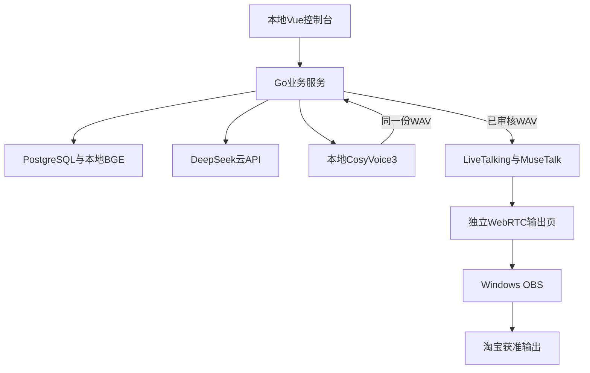

# 淘宝数字人直播本地部署开发计划

版本日期：2026-10-31
状态：v0.2本地测试功能已实现，本地准入验证和GitHub独立CI已通过；目标仓库为 gongzhiqiang666-star/shuziren。原始工期与目标机器验收继续保留，实际验证结果见 IMPLEMENTATION_STATUS.md。

执行版 2026年10月31日  依据已上传的技术部署成本与卖点方案

**本项目只服务淘宝直播。保留原商品管理、品牌人格、记忆、问答、审核、插播、人工接管和恢复的完整产品范围；DeepSeek作为唯一按量付费AI接口，语音、向量检索及数字人口型优先本地运行。先交付可本地启动的 v0.1 工作台，再按下述门槛完成目标电脑、模型效果与淘宝联调。**

## v0.2 更新：补齐本地测试工作流

在v0.1基础上实现独立OBS输出、活动与业务快照、商品/人格/记忆历史恢复、可复用商品话术模板、BGE CPU检索、资产版本、真实TTS引擎指纹及缓存、优先级/截止时间/定时派发、生成并发与保守额度、费用记录、官方淘宝TOP/TMC适配、诊断、备份恢复和音画校准工具。详细范围与证据分别见 [LOCAL_TEST_CONTRACT.md](LOCAL_TEST_CONTRACT.md) 和 [IMPLEMENTATION_STATUS.md](IMPLEMENTATION_STATUS.md)。

为减少本机安装依赖，BGE向量持久化使用PostgreSQL数组，Go进行精确余弦排名，暂不强制安装原先规划的pgvector扩展；小规模知识库保留语义检索功能，大规模索引优化继续单列。模板/资产台账是本地业务功能，真实头像、音色和模型配置需由媒体服务安装与核验，不能把档案修改当成已经切换GPU模型。

原384小时是完整工程与客户联调的初始估算，不是实际累计开发工时。真实GPU效果、8小时持续运行、Windows/WSL与OBS链路、已获权限淘宝实播继续由目标机器和真实账号验收。本次不使用协议替身给这些项目打勾。

## v0.1 历史执行：先完成本地工作台

用户已要求将失真、人物细节和口型控制写入计划并立即开发。具体控制与验收设计见[AVATAR_QUALITY.md](AVATAR_QUALITY.md)，已映射到 W00、W03、W04、W10、W11、W13、W16 和 W17。以下是第一版的交付切片，不代表下文全部 WBS 已完成。

| 优先级 | 第一版范围 | 交付判断 |
| --- | --- | --- |
| P0 | 本地网页、口令验证、PostgreSQL、店铺及商品版本 | 能实际录入、保存、更新；重启后资料仍在 |
| P0 | 人格配置、FAQ、人工维护记忆、DeepSeek 真实适配 | 生成草稿必须审核；没有配置时明确不可用 |
| P0 | 本地场次、审核、持久队列、取消、接管与恢复 | 资料版本和场次批次不符时拒绝旧任务；发送结果不明不自动重播 |
| P0 | 真实 CosyVoice3 HTTP 包装与 LiveTalking 适配 | 同一份 WAV 用于试听和口型驱动；支持媒体连接、上传、打断；实际模型另行验收 |
| P0 | 画质与口型核验档案 | 保存源素材、模型、画布、帧率和同步目标、逐项观察；人工记录不等于自动测量 |
| P1 | 可重复本地启动文件、CI、实际测试记录 | 源码、依赖锁文件、操作说明与未验证项一并交付 |

首版检索采用关键词；BGE 与 pgvector 仍保留在后续工作包。淘宝授权连接器、自动评论与商品同步、活动版本、完整记忆回滚、独立 OBS 媒体输出和长时 GPU 验收不提前标记完成。首版为本地单操作者，不宣称具备多用户租户权限。

开发顺序为：冻结接口 → 并行实现后端/前端/媒体 → 真实数据库与浏览器联调 → 提交任务分支和 PR → 目标机器模型联调。代码层验证通过后，下一轮优先用实际授权人物素材和新生成语句验证出声、口型、接管和资源占用，再接入已获准的淘宝路径。目标机器与账号未提供时，可以完成业务代码，不能把测试替身当成数字人效果通过。

媒体质量的首版实现与后续要求分开：同源音频校验和旧批次隔离进入代码；裁剪/遮罩/融合、头像及音色版本绑定、传输 PTS 测量、50 条语料及 8 小时压测在真实模型阶段实施。25fps、80ms 等仍为待实测目标，第一版不会把这些档案字段直接当作媒体配置生效。

以下保留完整产品开发计划和原工期预算。第一版推进不代表原 384 小时预算对应的全部上线工作已经完成。

### 推荐技术组合

| 职责 | 确定主线 | 位置 |
| --- | --- | --- |
| 控制与业务 | Vue 3 TypeScript + Go Gin + PostgreSQL | 客户电脑 |
| 文本生成 | DeepSeek deepseek-flash 非思考模式 | 官方云API |
| 中文语音 | Fun-CosyVoice3-0.5B-2512 | 本地独立服务 |
| 检索 | BGE-small-zh-v1.5 + PostgreSQL数组缓存与精确余弦排名；pgvector为后续规模优化 | 本地CPU |
| 数字人口型 | LiveTalking + MuseTalk | 本地NVIDIA GPU |
| 直播输出 | Windows OBS + 淘宝获准开播路径 | 本地与淘宝 |
| 淘宝连接器 | TOP TMC 授权和允许的数据同步 | 按平台批准位置 |

DeepSeek公开API的输出模态为文本，不能替代TTS或口型视频引擎。本计划将“只用DeepSeek”落实为唯一按量付费AI接口；“其他不动”落实为业务功能不缩水。[S01][S02]

### 工期和最早决定

基础开发320小时，另留64小时联调返工，共384小时。单人每周40小时约10周，每周30小时约13周；外部审批和硬件等待另计。前两周先验证淘宝实际路径、Windows音视频输出及本地TTS与口型同卡运行。

优先本地可以取消常驻云GPU采购，但不预设所有云费用归零。平台若要求连接器和相关数据处于指定环境，应按其批准范围部署并计费；如果要求超出小型连接器，应在首阶段重新估算。[S16]

## 一 需求范围与成本压缩方式

| 范围 | 本次安排 | 验收边界 |
| --- | --- | --- |
| 平台 | 只开发淘宝适配 | 其他平台不占本轮工期 |
| 原业务 | 商品 活动 FAQ 人格 记忆 审核 接管恢复均保留 | 逐项映射WBS与验收表 |
| 店铺与场次 | 保留多店配置 模板复用 多场次安排 | 首期单机同时一路；跨地域集中管理另需网络方案 |
| LLM | 统一DeepSeek，取消多厂商路由 | 一个权威文本入口，媒体层不二次自由生成 |
| 语音与向量 | 由原按量云服务改本地模型 | 接口及音质重新验收，不假设与云产品相同 |
| 部署 | Go Vue 数据库 媒体优先客户本机 | API和淘宝仍联网；受限数据按批准位置存放 |
| 成本策略 | 复用现有设备 预处理素材 缓存有效音频 | 保留新问题即时生成；不改为循环整段录播 |

### 哪些费用能压缩

主要减少每月云GPU、通用业务云服务器和直播媒体公网中转支出。固定讲解与FAQ在审核后预合成音频，商品或活动变化时只重做失效部分；新问题仍实时生成。BGE用CPU，显卡优先服务口型和语音。

只把Qwen换成DeepSeek不会消除语音和渲染成本，也不能预设文本单价一定更低。节省来自运行位置和重复计算减少。客户需要购买设备时，硬件和维护会替代部分云账单。

### 保持产品价值

面向客户的核心仍是少改话术、少做重复操作、品牌表达一致、商品事实可核对、遇到问题能接管。声音和口型模型属于实现组件；人格持续一致依赖规则、状态和可管理记忆。

本轮原云端CosyVoice可留作未启用的兼容配置，不能在本地故障时静默切到付费API。备选资源或不同硬件导致的成本与效果变化，必须在试点记录中明确。

## 二 本地系统架构

主验证环境为Windows 11加WSL2。Windows承载OBS、淘宝客户端和接入助手；WSL2承载业务服务、数据库以及隔离的Python推理环境。此组合是工程方案，尚未进行目标电脑实测。[S11][S12]

淘宝连接器按批准环境单独部署，以上图示仅展示生成与输出。

### Web仍然保留

Vue由本地Go服务提供，客户用浏览器操作。关闭管理页面不停止后台任务；OBS专用媒体源及输出进程需要保持运行。局域网访问在身份校验与允许网络范围内启用，默认不暴露公网入口。

### 淘宝数据连接单独隔离

淘宝连接器负责授权、TOP调用、TMC接收、确认和必要审计。若获准本地运行就与本机部署；若要求云环境则部署在指定区域，只传出获准且必要的字段。脱敏本身不等于获得外发许可。

## 三 淘宝接入是首个实施门槛

淘宝数字人服务商规则适用于入驻开放平台、上架服务市场并向商家提供数字人服务的主体。其企业与团队准入条件不能直接套用于普通商家自播；商家自用也不自动获得全部接口。首阶段确认采用商家自研、合资格合作方或其他获准路径。[S15]

| 能力 | 公开方法或消息 | 上线前证明 |
| --- | --- | --- |
| 评论 | taobao_liveaigc_CommentSend | AppKey可订阅；收到目标场次事件 |
| 直播与商品集合 | taobao.live.virtualanchor.get.live.detail | 应用权限 用户授权及场次关联成立 |
| 商品弹卡 | taobao.live.virtualanchor.push.item.card | 目标商品和直播间的实际成功调用 |
| 状态上报 | taobao.live.digitalanchor.get.reportstats | 按该接口要求上报真实状态 |
| 在售商品 | taobao.items.onsale.get | 卖家授权及字段范围可用 |
| 音视频输出 | 官方客户端输入或获准RTMP | 实际接收端画面 声音 接管均通过 |

上述能力存在官方文档，但不代表本项目已获授权。评论字段中的uniqueCode为可选，接入要处理缺失；商品列表只含部分信息，不能把price直接当所有买家的最终到手价。[S18][S19][S20][S21][S22]

### 数据和商业边界的交付物

产出能力确认表：主体与AppKey、API和消息权限、店铺与主播关联、调用IP、Token及数据位置、数字人标识、素材与音频缓存使用方式、允许的输出链路。TOP相关应用可能受聚石塔要求约束；以适用规则和实际批准为准。[S16]

TMC需消息服务和业务权限包，并受白名单及消息保留限制影响。连接器先可靠接收、去重和入队，再确认消息，LLM/TTS在后续执行；断线后的消息缺口应显示，不能承诺全部补回。[S17]

权限确认期间可以使用模拟数据完成研发，但自动评论、自动商品或弹卡未获真实验收时，其状态必须保留为未完成。

## 四 开发任务与依赖 上半部分

工时为单人工程估算。许可、账号审批及合作方等待不包含在内；以下验收均为未来要实现的标准。

| ID与工作包 | 小时 | 依赖 | 验收产物 |
| --- | --- | --- | --- |
| W00 需求映射与测试资料 | 8 | 无 | 原功能映射到模块与验收；准备商品与问题集 |
| W01 淘宝权限与商业路径 | 12 | W00 | 输出 评论 商品 状态和数据位置分别明确 |
| W02 Windows到淘宝输出 | 16 | W01 | 实际接收端音画正确；真人可接管 |
| W03 WSL与引擎版本锁定 | 16 | W00 | 可重复安装；记录代码和权重版本 |
| W04 WSL到OBS实时桥接 | 16 | W02 W03 | 动态句子进入输出；重连和关闭管理页行为明确 |
| W05 Go Vue 数据库与权限 | 20 | W00 | 身份 设备 商家隔离 配置持久化成立 |
| W06 商品版本与BGE检索 | 20 | W05 | 按商品和店铺查有效事实；增量更新索引 |
| W07 DeepSeek适配器 | 12 | W05 | 取消 超时 JSON校验 重试上限和用量记录 |
| W08 人格与可管理记忆 | 16 | W06 W07 | 风格一致；记忆不改价格；可修正与回滚 |

### 前两周必须优先得到的证据

先用已授权测试素材验证Windows到淘宝的画面和声音，再接入WSL媒体输出；随后同时运行本地TTS、MuseTalk、OBS和淘宝客户端，使用现场新输入句子测试。W10和W11中的可行性验证提前插入，后续工时用于完善服务和调度，不重复累计。

如果初始硬件、音频路由或平台路径不满足要求，及时形成调整结论。不要先完成大量页面，再把关键风险留到最后。

## 五 开发任务与依赖 下半部分

| ID与工作包 | 小时 | 依赖 | 验收产物 |
| --- | --- | --- | --- |
| W09 淘宝连接器与数据同步 | 20 | W01 W05 | 真实授权下收事件和查数据；权限失败可定位 |
| W10 本地语音服务 | 16 | W03 | 新句子即时合成；读音与音频格式可审核 |
| W11 资源控制与音频缓存 | 24 | W04 W05 W10 | 同卡无持续积压；缓存版本和失效正确 |
| W12 问答与审核流程 | 16 | W06至W09 | 问题合并；未知转人工；关键事实校验后入队 |
| W13 持久队列与完整接管 | 24 | W04 W11 W12 | 旧任务不复活；插播 重试 恢复状态一致 |
| W14 完整运营控制台 | 20 | W05至W13 | 多店配置 多场次 审核 插播 日志成本闭环 |
| W15 安装升级与备份诊断 | 24 | W13 W14 | 干净环境安装；恢复备份；版本可回滚 |
| W16 异常与长时验证 | 24 | W09至W15 | 断网 重启 资源竞争和过期话术有验收记录 |
| W17 首个客户试点 | 16 | W01 W16 | 培训 真实成本和维护工时记录；明确续用条件 |

**基础合计320小时；联调与返工储备64小时；总工程预算384小时。储备优先覆盖Windows音视频桥接、同卡竞争、淘宝接入与安装兼容性。**

| 周次 | 主要交付 |
| --- | --- |
| 第1至2周 | 完成账号路径确认、真实输出、本地资源组合的可行性验证 |
| 第3至4周 | 业务底座 商品与检索 DeepSeek 人格及连接器主体 |
| 第5至6周 | 本地语音 缓存 审核 调度 取消和人工接管闭环 |
| 第7至8周 | 完整控制台 安装升级 异常测试及首个试点候选 |
| 第9至10周 | 处理试点问题 完成目标电脑验收和交付资料 |

以上按每周40小时、前置条件及时到位安排。若每周30小时，按约13周规划。6至8周只适用于已有足够基础代码可复用且前期联调顺利的情况，不作为本次承诺。

## 六 DeepSeek与人格的实施细节

### 一个文本生成入口

由Go统一调用官方DeepSeek API，使用deepseek-flash，并显式设置thinking.type为disabled。采用JSON输出后做结构和业务校验；媒体引擎只接收批准的文本或音频，禁止额外再做一次自由生成。[S01][S03][S04]

| 工作 | 要实现的行为 |
| --- | --- |
| 请求组织 | 当前商品版本 活动有效期 人格版本 必要FAQ和会话摘要 |
| 结构校验 | 字段 类型 枚举 长度 空白输出 截断与缺失字段 |
| 事实校验 | 价格 数量 优惠和承诺以业务数据为准；不明信息转人工 |
| 资源控制 | 每场并发上限 超时 取消 有限重试和请求预算 |
| 输出闸门 | 未校验完整内容不进入TTS；记录生成与审批的版本 |
| 计费记录 | 实际输入 输出 缓存命中及高峰时段用量 |
| 数据边界 | 只发送获准外发的必要片段，不发送平台凭据或订单个人信息 |

### 人格保留四层

固定设定保存身份、语气和服务态度；品牌规则保存表达示例、读音词典和承诺边界；场次状态保存当前商品与已回答问题；长期记忆只保存有来源、可更正、可删除且获准使用的信息。人格版本可回滚，不把临时评论提升成系统指令。

同一商品事实在专业型、亲切型或活泼型表达下必须一致。TTS只承担经过验证的声线与表达参数；不能假设情绪指令自动实现持续一致的人格。

### 建议的核心任务字段

speech_job至少记录shop_id、session_id、epoch、product_version、promotion_version、persona_version、source_event_id、deadline、approved_text、audio_asset_id和执行状态。重试复用任务ID，迟到结果按epoch和有效期拒绝。

## 七 本地音视频与硬件验证

人物失真、嘴周细节、原生生成分辨率和口型同步按[画质、细节与口型控制方案](AVATAR_QUALITY.md)实施。该补充包含素材要求、逐头像校准、同源音频、传输同步和真实接收端验收，所有指标均待实测。

### 先锁定一条可用媒体路径

首选验证WSL2媒体WebRTC输出到Windows OBS专用浏览器源，再通过获准视频和音频输入进入淘宝客户端。若本机WebRTC链路不稳定，可验证本机RTMP中继到OBS作为替代桥接；最终交付只维护通过的一条路径。具备正式RTMP权限时，可采用获准直推。[S12][S13][S14]

WSL中的虚拟摄像头不会自动成为Windows的摄像头。画面、声音和真人麦克风分别验证；OBS场景可见不能代替淘宝实际收听确认。主控页面和媒体来源必须分开。

| 部分 | 实施与验收 |
| --- | --- |
| 推理环境 | LiveTalking集成环境与CosyVoice独立隔离；锁代码提交和权重版本 |
| 语音处理 | 金额 单位 品牌读音；统一采样率 声道 时间戳和缓冲 |
| 缓存 | 文本 音色 模型及表达参数参与缓存键；播放前校验商品有效期 |
| 资源控制 | TTS单任务起步；BGE用CPU；限制无效预生成和队列长度 |
| 音频接管 | 数字人静音与真人麦克风切换正确；无重复监听和通知声混入 |
| 停止与恢复 | 取消整条LLM TTS 媒体链；重连先核对场次和批次 |

### 硬件采用测试起点而非最低配置承诺

先复用或借用NVIDIA 24GB显存级别测试机，约8核CPU、32GB以上内存和SSD作为验证起点。按单路720p画布、25fps评估；不据此承诺任意型号都能实时运行。Mac可开发控制台，但当前CUDA媒体路线不列为标准Mac本地交付。

两个模型单独跑通不等于同卡实时。信号量只能限制任务提交，不能抢占正在执行的CUDA内核。必须在OBS和淘宝客户端同时运行时测显存、首音、最终帧率与持续运行。

## 八 业务状态与数据结构

| 实体 | 需要保存的关键内容 |
| --- | --- |
| shop 与 device | 商家边界 设备身份 可撤销授权与权限 |
| product_version | SKU 事实来源 版本 有效期和审核状态 |
| promotion_version | 活动起止 适用条件 已批准优惠及话术 |
| persona_version 与 memory | 人格版本 记忆来源 有效范围 修改删除记录 |
| live_session | 当前商品 场次状态 执行批次号和唯一执行者 |
| event_inbox | 平台消息标识 接收时间 去重状态 缺口提示 |
| speech_job | 来源 版本 有效期 审批 文本 音频 执行状态 |
| audio_asset | 音色 模型 文本参数哈希 生成成本及失效关联 |
| usage 与 audit | API用量 延迟 操作人 错误和状态转移 |

### 三种停止动作分开

暂停自动播报只停止新自动任务；停止媒体输出处理本地生成和输出；结束平台直播依赖淘宝实际控制能力。界面分别显示状态。已发送到平台或观众已经听到的内容无法由本地取消撤回。

### 消息与外部操作的可靠性

接收消息后先按允许的存储位置可靠保存和去重，再确认消费。评论合并与消息幂等分开，避免把合法重复提问误当传输重投。平台弹卡等操作若结果不明，先核对状态或转人工，不无限重试。

### 本地运行与凭据

建议每客户使用自己的DeepSeek凭据，仅保存在本地受保护配置中。平台AppSecret和Token按平台指定位置保存，均不进入网页、通用安装包、仓库或日志。本地助手只接受限定命令，本机紧急停止不依赖云连接。

## 九 验收标准与证据等级

以下为拟定验收条件，不表示已完成测试。首音和帧率数值在前两周测得基线后冻结，若不满足业务目标，应报告硬件或方案调整，不用模拟结果代替真实链路。

| 验收项 | 通过条件 | 证据 |
| --- | --- | --- |
| 真实淘宝接入 | 指定账号收到画面 声音和真实评论；权限失败有明确状态 | 测试场次记录与脱敏日志 |
| 动态生成 | 现场新问题实时经过DeepSeek 本地TTS和口型输出 | 请求任务链与接收端记录 |
| 商品事实 | 测试集中不播过期价或编造优惠；缺事实转人工 | 版本及审批追踪 |
| 跨店隔离 | 其他商家数据和任务不可被当前身份读取执行 | 权限与检索测试 |
| 人格与记忆 | 同事实不同风格一致；更正与删除后不继续引用旧记忆 | 回归问题集 |
| 完整打断 | 接管后旧批次不能重新形成新的本地输出 | 迟到结果和重连用例 |
| 资源与持续运行 | 计划负载连续8小时，无崩溃或持续队列增长 | GPU CPU 内存 帧率和延迟曲线 |
| 首音与同步 | 统计接收新问题到第一段可听音频的p50/p95及音画差 | 本机与平台分别测量 |
| 断网恢复 | 显示消息缺口；恢复时不补播过期内容或重复开场 | 故障注入记录 |
| 安装与回滚 | 干净支持环境可安装；备份恢复及失败升级回滚成功 | 步骤和版本清单 |
| 成本 | 实际tokens 电耗 维护时长和必要平台费用可核对 | usage与账单或功耗记录 |

建议初始首音目标为p95不超过5秒，但这是待验证目标；最终以约定的文本长度、负载、网络和硬件为前提。固定视频播放、单独模型FPS或Mock接口通过，都不能当作完整产品验收。

## 十 本地成本重新测算

沿用原方案单路每天8小时、每月30天，加每日0.5小时准备，共255设备小时。下列数字是示例预算，平台费用与硬件条件未确认；不能直接沿用原云端约2000元口径。

### DeepSeek按原用量估算

每月4800轮问答，另加100次脚本和240次摘要，合计输入1556万tokens、输出81.8万tokens。按全部未命中缓存及10%重试，Flash费用约20.72至41.43元，范围对应全部空闲价到全部高峰价。真实JSON输出和上下文用量应以usage替换。[S01]

| 费用项目 | 示例金额 元每月 | 条件与口径 |
| --- | --- | --- |
| DeepSeek | 20.72至41.43 | 按上述用量，无缓存折扣假设 |
| 本地TTS和向量API费 | 0 | 本地计算仍消耗资源 |
| 云GPU与通用业务云主机 | 0 | 相应工作已在本机完成 |
| 设备电费 | 91.80 | 平均0.45kW × 255小时 × 0.8元每度 |
| 备份预算 | 20.00 | 内部占位，按实际存储方案替换 |
| 已量化运行现金小计 | 132.52至153.23 | 不含下述未报价项目 |
| 加15%准备金 | 152.39至176.21 | 小计按未舍入数计算 |
| 平台及其他新增月费 C | 待确认 | 连接器云环境 合作费 接口费 增量宽带等 |

完整运行现金预算为152.39至176.21元加1.15×C。电费按占用整机的示例分摊；若讨论增量成本，应使用实测新增功耗。现有宽带需满足稳定上行，新增费用不能默认为零。

设备投入记为H；按36个月摊销为H/36。仅举例H为9000元，则月折旧250元，这不是硬件报价。再按维护4小时×150元加600元，含折旧和维护的服务预算约1002.39至1026.21元加1.15×C；尚未计全部研发、获客、税费或额外许可。

该表是客户一台机器的整体口径。客户自付硬件和DeepSeek时，成本转移到客户侧，不能把这部分直接算成我们的利润；本地售后工时须通过试点重新测量。

## 十一 GitHub项目与提交计划

**用户已指定仓库 https://github.com/gongzhiqiang666-star/shuziren。2026-10-31初始化时为空的公开仓库，默认分支为main。初始化资料、v0.1与v0.2业务开发按任务分支和PR交付；当前完整本地代码位于codex/local-test-ready，实际提交与CI见交付记录。**

### 仓库建议

使用用户指定的独立仓库 gongzhiqiang666-star/shuziren。先初始化README，再提交开发计划、验收标准、来源与依赖记录和.gitignore；这些文档不代表已完成功能。后续使用任务分支，每个提交对应可核对的工作包。仓库当前为公开，提交内容可被公开查看。

| 当前目录 | 责任 |
| --- | --- |
| server/ | Go业务 商品 人格 调度 DeepSeek 淘宝连接器 |
| web/ | Vue运营台 预览 审核 插播与诊断入口 |
| server/internal/media/ | LiveTalking与MuseTalk适配及媒体会话 |
| workers/tts/ | 本地CosyVoice3服务与音频协议 |
| workers/retrieval/ | CPU向量服务与模型固定 |
| scripts/ 与 compose*.yaml | 本地启动、诊断、备份恢复和音画校准；Windows/WSL驱动与OBS按手册安装 |
| docs/ 与 tests/ | 架构 接口 验收与脱敏测试数据 |

### 提交顺序

先提交开发计划；随后依次提交本地运行骨架、媒体链路验证、商品与检索、DeepSeek与人格、淘宝连接器、本地TTS与缓存、完整调度与接管、安装交付和验收修复。开发分支建议采用codex/任务名称，main保留可审查的稳定版本。

Go与Vue测试和构建在CI执行；GPU和淘宝真实验收放在明确的测试环境，不冒充GitHub通用运行器已验证。每次交付给出commit、修改文件、真实测试命令与退出码、未验证项。

仓库排除密钥、账号Token、客户数据、人物与声音素材、模型权重、日志、备份和依赖缓存；保存模型来源、版本和校验值。是否开源应用代码另行决定，不随依赖许可自动公开。

## 十二 首批行动和继续投入条件

| 顺序 | 具体行动 | 完成物 |
| --- | --- | --- |
| 1 | 已确定并授权GitHub独立仓库 shuziren | 写入已验证；README初始化和开发资料收录 |
| 2 | 选定一个试点淘宝商家与一台目标电脑 | 平台能力表 硬件配置 操作系统和上行网络 |
| 3 | 核验数字人使用和应用路径 | 主体方式 权限包 数据位置及必要费用 |
| 4 | 准备获授权形象 声音与少量商品 | 素材来源 10个商品 50条验证问题 |
| 5 | 验证Windows画面和声音进入真实接收端 | 选定的视频 音频和接管路径 |
| 6 | 验证本地TTS 口型 OBS同时运行 | 现场新句子 延迟 帧率与资源记录 |

### 可以进入完整开发的条件

平台路径有依据，核心接口已具备或有明确可执行的获取方案；硬件组合能够满足约定目标；核心素材和软件使用条件明确；平台必要费用没有破坏客户可接受的总成本。

### 需要调整的情况

如果数字人或评论能力无法获准，保持对应任务未完成，可继续本地预演和不依赖权限的研发；不能把人工输入替代版当成全部功能交付。若平台要求更大范围驻云或同卡算力不够，应先更新部署与成本，再承诺客户价格。

### 交付状态

已完成需求收敛、官方资料核验、WBS与成本测算、验收设计及v0.2本地业务代码。BGE模型已在CPU实际加载并完成语义检索功能测试；完整证据见[交付记录](IMPLEMENTATION_STATUS.md)。尚未执行真实CosyVoice/MuseTalk GPU部署、账号登录、淘宝实播或8小时GPU压测。本计划中的性能目标、原工期和收益须在相应条件下验证。

本计划沿用原方案的产品价值与业务功能，具体实现以本执行版的淘宝范围、DeepSeek接口、本地服务边界和验收记录为准。价格与资料核验日期为2026年10月31日，发生变化时更新相应记录。

## 官方来源

核验日期：2026-10-31。

- [S01] [DeepSeek 模型与人民币价格](https://api-docs.deepseek.com/zh-cn/quick_start/pricing/)：当前模型名 高峰与空闲价格。
- [S02] [DeepSeek 模型输出模态](https://api-docs.deepseek.com/api/list-models/)：公开模型的输出类型为文本。
- [S03] [DeepSeek 思考模式](https://api-docs.deepseek.com/zh-cn/guides/thinking_mode/)：默认启用思考及关闭参数。
- [S04] [DeepSeek JSON Output](https://api-docs.deepseek.com/zh-cn/guides/json_mode/)：JSON格式配置及空白或截断处理。
- [S05] [LiveTalking 官方仓库](https://github.com/lipku/LiveTalking)：引擎 输出方式 集成依赖及许可。
- [S06] [MuseTalk 官方仓库](https://github.com/TMElyralab/MuseTalk)：口型模型 权重与示例素材使用边界。
- [S07] [CosyVoice 官方仓库](https://github.com/QwenAudio/CosyVoice)：中文流式语音与独立Python环境。
- [S08] [CosyVoice3 指定权重](https://huggingface.co/FunAudioLLM/Fun-CosyVoice3-0.5B-2512)：指定权重模型卡标示Apache-2.0。
- [S09] [BGE中文小模型](https://huggingface.co/BAAI/bge-small-zh-v1.5)：中文检索向量与MIT许可。
- [S10] [SentenceTransformers 参数](https://www.sbert.net/docs/package_reference/sentence_transformer/model.html)：CPU设备和本地模型加载选项。
- [S11] [NVIDIA CUDA on WSL](https://docs.nvidia.com/cuda/wsl-user-guide/index.html)：WSL2使用GPU的环境和驱动要求。
- [S12] [Microsoft WSL 网络](https://learn.microsoft.com/en-us/windows/wsl/networking)：NAT 镜像网络与主机互联差异。
- [S13] [OBS Browser Source](https://obsproject.com/kb/browser-source)：本地或URL网页作为音视频源。
- [S14] [OBS 虚拟摄像头](https://obsproject.com/kb/virtual-camera-guide)：场景输出为本机摄像头来源。
- [S15] [淘宝数字人服务商管理规则](https://developer.alibaba.com/docs/doc.htm?articleId=122141&docType=1&source=search&treeId=23)：适用范围及服务市场准入。
- [S16] [淘宝合作伙伴应用安全规范](https://developer.alibaba.com/docs/doc.htm?articleId=106998&docType=1&treeId=285)：TOP调用环境 授权与数据处理边界。
- [S17] [淘宝消息服务使用介绍](https://developer.alibaba.com/docs/doc.htm?articleId=101663&docType=1&treeId=456)：权限包 白名单 消费确认及消息缺口。
- [S18] [淘宝数字人评论推送](https://developer.alibaba.com/docs/topicDetail.htm?apiId=2664)：taobao_liveaigc_CommentSend消息结构。
- [S19] [淘宝数字人直播详情](https://developer.alibaba.com/docs/api.htm?apiId=68922)：直播间与关联商品信息及授权要求。
- [S20] [淘宝数字人商品弹卡](https://developer.alibaba.com/docs/api.htm?apiId=69650)：商品弹卡方法及授权要求。
- [S21] [淘宝数字人状态上报](https://developer.alibaba.com/docs/api.htm?apiId=70592)：状态字段及每5分钟上报说明。
- [S22] [淘宝在售商品列表](https://developer.alibaba.com/docs/api.htm?apiId=18&source=search)：卖家授权及商品基础字段的范围。
